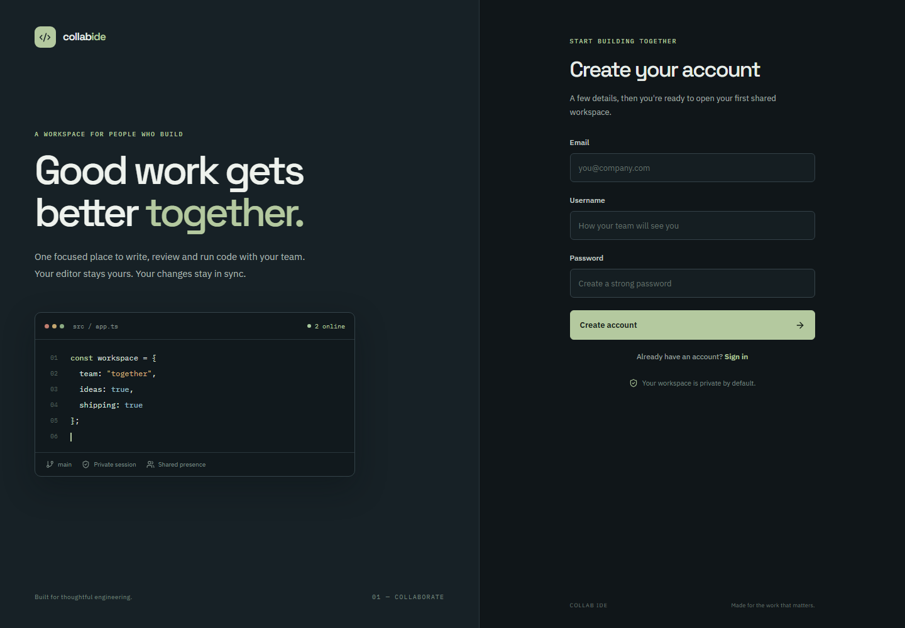
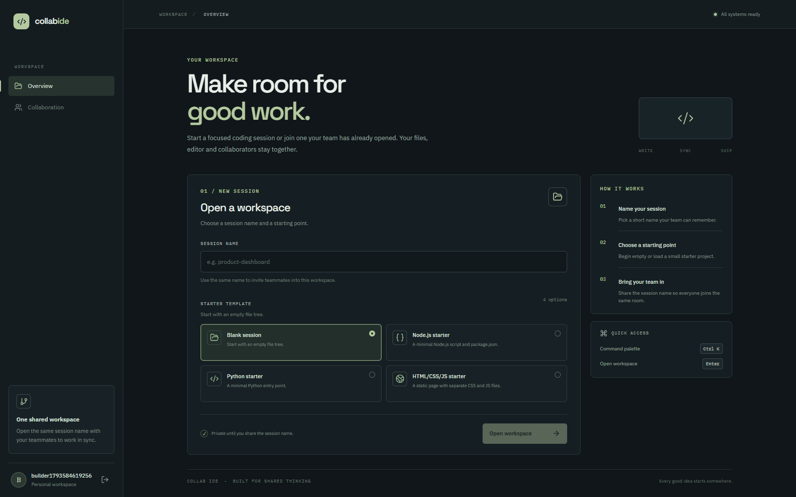
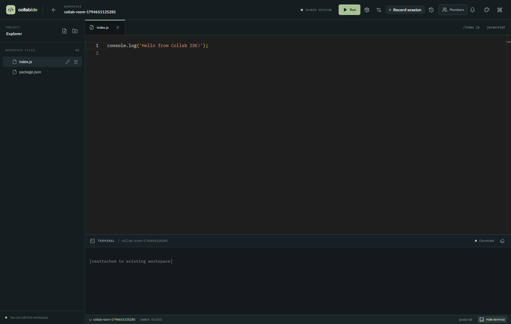
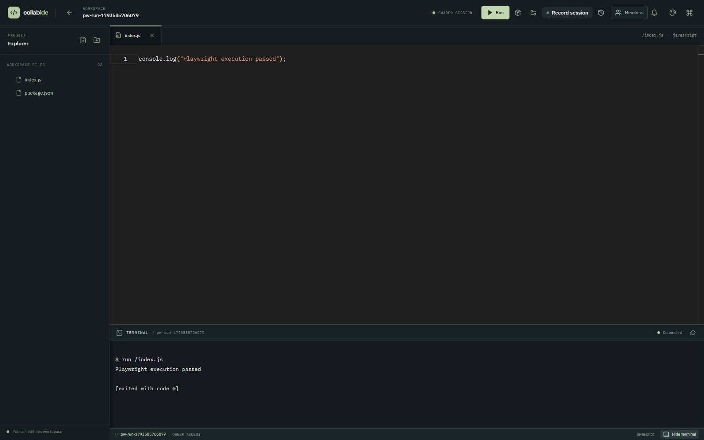
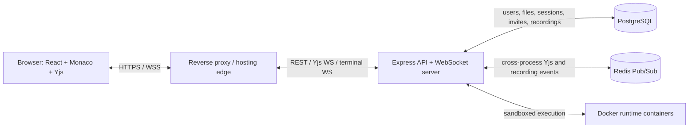

# Collab IDE

[](https://github.com/shehzadres/collab-ide/actions/workflows/ci.yml)
[](LICENSE)
[](https://nodejs.org/)

**A real-time collaborative development environment in the browser.**

Collab IDE brings a shared code editor, file workspace, presence, session permissions, invitations, and session replay into one browser-based workspace. It is built with React, TypeScript, Monaco, Yjs, Express, PostgreSQL, Redis, and Docker.

- **Live preview:** [collab-ide-frontend-iota.vercel.app](https://collab-ide-frontend-iota.vercel.app)
- **Source code:** [github.com/shehzadres/collab-ide](https://github.com/shehzadres/collab-ide)
- **License:** [MIT](LICENSE)

> **Hosted demo note:** The hosted frontend is configured for demo hosting. Docker-dependent features such as the interactive terminal, Run, Install, and workspace container controls are disabled when demo mode is enabled. Run the project locally or self-host it with Docker to use the complete execution environment.

## Product walkthrough

These are real application captures from the project, not mockups.

| Registration | Session overview |
| --- | --- |
|  |  |
| Collaborative editor | Code execution |
|  |  |

---

## Contents

- [What it does](#what-it-does)
- [Architecture](#architecture)
- [Technology](#technology)
- [Getting started](#getting-started)
- [Environment configuration](#environment-configuration)
- [Development commands](#development-commands)
- [Testing and verification](#testing-and-verification)
- [Browser acceptance and performance](#browser-acceptance-and-performance)
- [Roles and access](#roles-and-access)
- [Execution and sandboxing](#execution-and-sandboxing)
- [Recording and replay](#recording-and-replay)
- [Deployment](#deployment)
- [Repository guide](#repository-guide)
- [Known limitations](#known-limitations)
- [Documentation](#documentation)
- [Contributing](#contributing)
- [Security](#security)
- [License](#license)

## What it does

| Area | Capabilities |
| --- | --- |
| Collaborative editing | Yjs CRDT documents, concurrent editing, live cursors, selections, and participant presence |
| Code editor | Monaco Editor, syntax-aware editing, tabs, themes, and keyboard shortcuts |
| Workspace files | Create, rename, move, and delete files and folders; persist file contents |
| Access control | Per-session OWNER, EDITOR, and VIEWER roles |
| Invitations | Shareable invite links with role assignment, expiry, and usage limits |
| Execution | Isolated Docker workspaces with Shell, Node.js, Python, and Go runtimes |
| Terminal | Interactive terminal sessions with reconnect support |
| Session history | Record collaborative updates and inspect a replay timeline |
| Productivity | Command palette, project templates, notifications, and workspace settings |

## Architecture

The frontend communicates with one backend over HTTP and WebSockets. PostgreSQL stores durable application data; Redis distributes collaboration and recording state between backend processes. Docker is used by the backend to create isolated execution workspaces.



### Collaboration flow

1. A participant opens a workspace and the backend checks session membership.
2. The browser joins the session's Yjs document over WebSocket.
3. Yjs exchanges document updates and awareness information between participants.
4. The backend persists file content and uses Redis pub/sub to distribute updates when multiple backend processes are running.
5. Session role checks protect file mutations, terminal access, invitations, and recording controls.

### Design notes

- The editor uses Yjs CRDT updates to merge concurrent changes.
- REST and WebSocket endpoints share the backend HTTP server.
- Access tokens are held in frontend memory; refresh tokens use an HTTP-only cookie.
- The Docker execution environment is separate from the browser editor and is disabled in demo mode.

## Technology

| Layer | Technologies |
| --- | --- |
| Frontend | React 18, TypeScript, Vite, Tailwind CSS, Zustand, React Router |
| Editor | Monaco Editor, Yjs, y-monaco, y-websocket |
| Terminal UI | xterm.js |
| Backend | Node.js 20+, Express, TypeScript |
| Database | PostgreSQL, Prisma ORM |
| Collaboration | Yjs, WebSockets, Redis pub/sub |
| Authentication | bcrypt, JWT access/refresh tokens, HTTP-only refresh cookie |
| Execution | Docker, Dockerode, Shell, Node.js, Python, Go |
| Delivery | Docker Compose, Nginx, GitHub Actions, Vercel, Railway-compatible backend deployment |

## Getting started

### Prerequisites

- Node.js 20 or newer and npm
- Docker Desktop or Docker Engine
- Git
- At least one local PostgreSQL and Redis instance, or use the supplied Docker Compose services

### Option A: Run the complete stack with Docker Compose

This is the simplest way to run the complete application, including the Docker-backed execution environment.

1. Clone the repository:

   ```bash
   git clone https://github.com/shehzadres/collab-ide.git
   cd collab-ide
   ```

2. Create the root environment file:

   ```bash
   cp .env.example .env
   ```

   On Windows PowerShell:

   ```powershell
   Copy-Item .env.example .env
   ```

3. Edit `.env`. Replace the sample database password and both JWT secrets with unique local values. The JWT secrets must be different and at least 32 characters long. For this full-stack Compose setup, set `CLIENT_URL=http://localhost` because the browser opens the Nginx frontend on port 80. For the separate Vite development workflow below, use `CLIENT_URL=http://localhost:5173`.

4. Build and start the services:

   ```bash
   docker compose --env-file .env -f docker/docker-compose.yml up -d --build
   ```

   Compose starts PostgreSQL, Redis, the migration job, backend, frontend, and the four executor image builders.

5. Open [http://localhost](http://localhost).

The frontend is served through Nginx. Nginx proxies `/api`, `/ws`, and `/terminal` to the backend. PostgreSQL, Redis, and the backend diagnostic port are bound to loopback in the supplied Compose configuration.

To inspect service health and logs:

```bash
docker compose --env-file .env -f docker/docker-compose.yml ps
docker compose --env-file .env -f docker/docker-compose.yml logs -f backend
```

Stop the stack without deleting database data:

```bash
docker compose --env-file .env -f docker/docker-compose.yml down
```

Only remove volumes when you intentionally want to delete local database data:

```bash
docker compose --env-file .env -f docker/docker-compose.yml down -v
```

### Option B: Run the frontend and backend in development mode

Use this workflow when you want hot reload and to work directly on the React or Express source.

1. Clone the repository and create the root environment file as described above.
2. Start only PostgreSQL and Redis:

   ```bash
   docker compose --env-file .env -f docker/docker-compose.yml up -d postgres redis
   ```

3. Copy the application environment examples:

   ```bash
   cp backend/.env.example backend/.env
   cp frontend/.env.example frontend/.env
   ```

   On Windows PowerShell:

   ```powershell
   Copy-Item backend/.env.example backend/.env
   Copy-Item frontend/.env.example frontend/.env
   ```

4. Update `backend/.env` with the same local JWT secrets used in the root `.env`. Confirm that its database URL points to the Compose host port `55432`, Redis points to `localhost:6379`, and `CLIENT_URL` is `http://localhost:5173`.
5. Install dependencies:

   ```bash
   npm ci
   npm ci --prefix backend
   npm ci --prefix frontend
   ```

6. Apply database migrations and start both applications:

   ```bash
   npm run prisma:migrate --prefix backend
   npm run dev
   ```

7. Open [http://localhost:5173](http://localhost:5173).

The Vite development server proxies API and WebSocket traffic to the backend on port 4000. Keep the default same-origin frontend URLs in `frontend/.env` for local development.

> **Execution in development mode:** The editor and API can run as separate Node processes, but Docker-backed Run and terminal features also require the backend process to have access to the Docker daemon and the four executor images. The complete Compose workflow configures this path for you.

## Environment configuration

Never commit real environment files. The examples below contain placeholders only.

### Root `.env` (Docker Compose)

| Variable | Purpose |
| --- | --- |
| `POSTGRES_USER` | Local PostgreSQL user |
| `POSTGRES_PASSWORD` | Local PostgreSQL password; replace the sample |
| `POSTGRES_DB` | Database name |
| `DOCKER_GID` | Docker socket group ID on Linux; Docker Desktop commonly uses the default |
| `JWT_ACCESS_SECRET` | Access-token signing secret, at least 32 characters in production |
| `JWT_REFRESH_SECRET` | Refresh-token signing secret; must differ from the access secret |
| `CLIENT_URL` | Allowed browser origin for CORS |

### `backend/.env`

| Variable | Required | Purpose |
| --- | --- | --- |
| `NODE_ENV` | No | Set to `production` for production |
| `PORT` | No | HTTP server port; defaults to `4000` |
| `DATABASE_URL` | Yes | PostgreSQL connection string |
| `REDIS_URL` | No | Redis connection string; defaults to local Redis |
| `JWT_ACCESS_SECRET` | Yes | Access-token signing secret |
| `JWT_REFRESH_SECRET` | Yes | Refresh-token signing secret |
| `ACCESS_TOKEN_TTL` | No | Access token lifetime; defaults to `15m` |
| `REFRESH_TOKEN_TTL` | No | Refresh token lifetime; defaults to `7d` |
| `CLIENT_URL` | Yes | Allowed frontend origin; comma-separated origins are supported |
| `MAX_TERMINAL_SESSIONS` | No | Maximum active terminal sessions; defaults to `50` |
| `TERMINAL_IDLE_TIMEOUT_MS` | No | Terminal WebSocket idle timeout; defaults to `600000` |
| `DEMO_MODE` | No | Set to `true` to disable Docker-dependent execution features |

### `frontend/.env`

| Variable | Purpose |
| --- | --- |
| `VITE_API_URL` | REST API base path |
| `VITE_YJS_WS_URL` | Yjs WebSocket base URL |
| `VITE_TERMINAL_WS_URL` | Terminal WebSocket URL |
| `VITE_DEMO_MODE` | Set to `true` to hide Docker-dependent controls in the UI |

For local development, keep the values in `frontend/.env.example`. For a separate-domain deployment, set the frontend API and WebSocket URLs to the deployed backend and configure backend `CLIENT_URL` to the exact frontend origin. Keep backend `DEMO_MODE` and frontend `VITE_DEMO_MODE` aligned.

Generate two different secrets locally:

```bash
node -e "console.log(require('node:crypto').randomBytes(48).toString('hex'))"
```

Run the command twice, once for each JWT secret. Do not reuse the example placeholders in production.

## Development commands

Run commands from the repository root unless a working directory is shown.

| Command | Description |
| --- | --- |
| `npm run dev` | Start backend and frontend development servers |
| `npm run dev:backend` | Start the backend only |
| `npm run dev:frontend` | Start the frontend only |
| `npm run install:all` | Install backend and frontend dependencies |
| `npm run typecheck` | Typecheck backend and frontend |
| `npm test` | Run backend unit tests |
| `npm run build` | Build backend and frontend |
| `npm run smoke:local` | Run local runtime and terminal integration checks |
| `npm run smoke:collaboration` | Run collaboration, invitation, and authorization checks |

## Testing and verification

The GitHub Actions workflow runs on pushes and pull requests targeting `main`. It installs dependencies, audits packages, runs backend unit tests, typechecks and builds both applications, starts the Docker Compose environment, waits for backend health, runs the local runtime and collaboration smoke suites, and executes a Chromium browser acceptance test. Browser reports, screenshots, traces, and failure video are uploaded as a CI artifact.

Run the main checks locally:

```bash
npm ci
npm ci --prefix backend
npm ci --prefix frontend
npm audit --audit-level=high --prefix backend
npm audit --audit-level=high --prefix frontend
npm test
npm run typecheck
npm run build
```

For the integration suites, start the full Docker Compose stack and ensure PostgreSQL, Redis, Docker, and all four executor images are available:

```bash
npm run smoke:local
npm run smoke:collaboration
```

> **Important:** The smoke suites create temporary users, sessions, files, and Docker workspaces, then clean them up. Run them only against a disposable local/test database and test backend. Do not point these commands at production data.

The collaboration suite covers role authorization, invitation lifecycle and usage limits, concurrent invitation redemption, Yjs synchronization, viewer write restrictions, terminal authorization, socket revocation, and owner-assignment edge cases. The local runtime suite exercises Shell, Node.js, Python, Go, workspace reset, and authenticated terminal behavior.

See [QA_NOTES.md](QA_NOTES.md) for the verification record and [GitHub Actions](https://github.com/shehzadres/collab-ide/actions) for CI runs.

## Browser acceptance and performance

The Playwright browser smoke test covers registration, the session overview, and opening a workspace as its OWNER. Run it locally after starting the complete Docker Compose stack:

```bash
npm install --no-save --no-package-lock @playwright/test
npx playwright install chromium
npx playwright test
```

A low-volume health endpoint sampler is available for baseline timing. It reports min/mean/p50/p95/max and is not a load test:

```bash
PERF_BASE_URL=http://127.0.0.1:4000 PERF_PATH=/health PERF_SAMPLES=30 node scripts/measure-http.mjs
```

See [Browser and performance evidence](docs/BROWSER_AND_PERFORMANCE_EVIDENCE.md) for safe production measurement and screenshot guidance. Do not present health-route timing as an application performance benchmark.

## Roles and access

Roles are assigned per workspace/session.

| Capability | OWNER | EDITOR | VIEWER |
| --- | :---: | :---: | :---: |
| View workspace and collaborate | Yes | Yes | Yes |
| Create and modify files | Yes | Yes | No |
| Run code and use terminal | Yes | Yes | No |
| Manage members and invitations | Yes | No | No |
| Start and manage recordings | Yes | No | No |
| Change workspace network access | Yes | No | No |

The first participant to create/open a new session is assigned OWNER. Additional participants should join through an invitation link with the intended role. Authorization is enforced by the backend, not only by hiding frontend controls.

## Execution and sandboxing

When execution is enabled, each session uses a Docker workspace with one of four runtimes:

| Runtime | Image | Main command |
| --- | --- | --- |
| Shell | `collab-ide-executor-shell` | `/bin/sh` |
| Node.js | `collab-ide-executor-node` | `node` |
| Python | `collab-ide-executor-python` | `python3` |
| Go | `collab-ide-executor-go` | `go run` |

The executor configuration applies resource limits and drops Linux capabilities. Network access is disabled by default. An OWNER can enable network access for a workspace when package installation requires it. Enabling it grants broader outbound network access; it is not a per-domain allowlist.

Execution containers require a backend host with Docker daemon access. A multi-replica backend deployment must also account for where containers are created and attached; Redis synchronizes collaboration state, but it is not a distributed container scheduler.

## Recording and replay

An OWNER can start and stop a session recording. The recording pipeline stores collaborative document updates and periodic snapshots so a replay can reconstruct editor state and seek through the session timeline. Access to recording controls is role-restricted.

## Deployment

### Docker Compose

For a self-hosted single-machine deployment, use the complete Compose workflow in [Getting started](#getting-started). Before exposing the application publicly:

- Set strong, unique JWT secrets and database credentials.
- Set `CLIENT_URL` to the exact public frontend origin.
- Use HTTPS/WSS through a trusted reverse proxy or hosting platform.
- Keep PostgreSQL, Redis, and diagnostic backend ports private.
- Configure persistent storage and backups for PostgreSQL.
- Review Docker socket access and execution-network policy for your threat model.

### Separate frontend and backend hosting

The frontend can be built as a static Vite application and hosted on a static hosting provider. The backend requires Node.js, PostgreSQL, Redis, and (when execution is enabled) a Docker host accessible to the backend process.

Configure the frontend build variables (`VITE_API_URL`, `VITE_YJS_WS_URL`, `VITE_TERMINAL_WS_URL`, and `VITE_DEMO_MODE`) and the backend runtime variables described above. Apply Prisma migrations before serving traffic. Configure the hosting platform to route SPA paths to `index.html` and allow WebSocket upgrades for `/ws` and `/terminal`.

The repository includes a Vercel SPA rewrite in `frontend/vercel.json` and an Nginx reverse-proxy configuration for the Docker Compose deployment.

## Repository guide

```text
collab-ide/
├── .github/
│   └── workflows/ci.yml       # CI: audits, tests, builds, Docker smoke suites
├── backend/
│   ├── prisma/                # Prisma schema and migrations
│   ├── src/
│   │   ├── modules/           # Auth, files, sessions, permissions, execution, Yjs
│   │   ├── middleware/        # Authentication, errors, rate limits
│   │   ├── websocket/         # WebSocket and terminal servers
│   │   └── server.ts          # HTTP server entry point
│   └── test/                  # Unit and integration smoke tests
├── frontend/
│   ├── src/
│   │   ├── components/        # Editor, explorer, terminal, replay, workspace UI
│   │   ├── hooks/             # Collaboration and application hooks
│   │   ├── lib/               # API, Yjs, editor, templates, replay
│   │   ├── pages/             # Route-level screens
│   │   └── store/             # Zustand state
│   └── vercel.json            # SPA fallback
├── docker/                    # Compose, Nginx, executor Dockerfiles
├── docs/                      # Architecture, security, collaboration, testing, scale, showcase
├── QA_NOTES.md                # Verification history
├── UI_REDESIGN.md             # Visual system and interface rationale
├── CONTRIBUTING.md
├── SECURITY.md
└── README.md
```

## Known limitations

- Hosted demo mode disables Docker-backed execution, terminal, package installation, and workspace container controls.
- Full execution requires a backend host with access to Docker; a static frontend deployment cannot provide this by itself.
- Network access for package installation is an OWNER-controlled workspace setting, but currently enables general container egress rather than a registry-only allowlist.
- The Docker execution setup is designed around a Docker host accessible to the backend. Redis handles collaboration state distribution; it does not schedule containers across machines.
- The editor and file collaboration model is session-scoped. Organization/team administration and global user management are outside the current scope.

## Documentation

The deeper engineering guides are maintained separately so the README stays useful as a project entry point:

| Guide | What it covers |
| --- | --- |
| [Architecture](docs/ARCHITECTURE.md) | Frontend/backend boundaries, data flow, persistence, execution |
| [Security model](docs/SECURITY_MODEL.md) | Trust boundaries, authorization, Docker risks, recording privacy |
| [Collaboration flow](docs/COLLABORATION_FLOW.md) | Session lifecycle, invitations, Yjs synchronization, role revocation |
| [Testing strategy](docs/TESTING_STRATEGY.md) | Test layers, safe execution, regression matrix, evidence standards |
| [Scalability](docs/SCALABILITY.md) | Current scaling model, Docker scheduling boundary, benchmark plan |
| [Recruiter showcase guide](docs/SHOWCASE_GUIDE.md) | Real screenshot/GIF capture plan and concise demo script |
| [Browser and performance evidence](docs/BROWSER_AND_PERFORMANCE_EVIDENCE.md) | Playwright acceptance, CI artifacts, low-volume latency measurement |\n| [Cross-repository quality gap review](docs/QUALITY_GAP_REVIEW.md) | Comparison with the other portfolio repositories and remaining evidence gaps |

The showcase guide deliberately describes assets to capture rather than presenting mock screenshots as evidence. Add real screenshots and a two-browser collaboration recording after verifying them against the current application.

## Contributing

Issues and pull requests are welcome. Before opening a pull request, run the checks relevant to your changes and read [CONTRIBUTING.md](CONTRIBUTING.md). Keep changes focused, document configuration changes, and never include real credentials or local environment files.

## Security

Please do not report exploitable vulnerabilities in public issues. Read [SECURITY.md](SECURITY.md) for responsible disclosure guidance.

## License

This project is licensed under the [MIT License](LICENSE).
