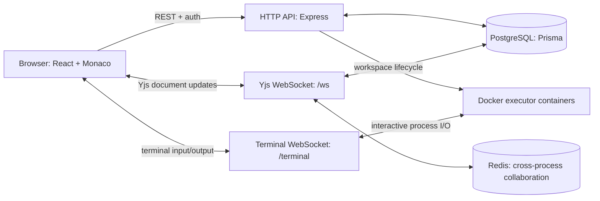

# Architecture

This document describes the current repository architecture and its operational boundaries. It is intended to help contributors trace a user action through the system before changing a subsystem.

## System at a glance

The diagram is a logical view, not a promise that every hosted deployment enables every subsystem. In particular, the public demo runs with Docker-dependent features disabled.

## Frontend

The frontend is a Vite/React single-page application. Its major responsibilities are:

- Route-level application screens and workspace navigation.
- Monaco editor integration.
- Yjs document binding through the collaboration client and `y-monaco`.
- Workspace file explorer, terminal, session controls, and replay UI.
- Client-side role-aware affordances.

The frontend is not an authorization boundary. Hiding a button is a usability decision; the backend must independently authorize the corresponding operation.

## Backend

The backend is a Node.js/TypeScript service. The HTTP application and WebSocket servers share the same HTTP server process. Important areas include:

- `src/modules/`: domain behavior such as authentication, sessions, files, permissions, execution, and Yjs collaboration.
- `src/middleware/`: request authentication, error handling, and rate limiting.
- `src/websocket/`: WebSocket transport and terminal connections.
- `src/config/env.ts`: environment parsing and production secret checks.
- `src/server.ts`: server startup and graceful shutdown.

The process shutdown path stops the workspace reaper, closes the HTTP listener, flushes the recording buffer, and disconnects Prisma and Redis.

## Persistence and coordination

PostgreSQL is the durable relational store, accessed through Prisma. The schema includes users, per-session membership, invitations, files, workspaces, session recordings, and recording events.

Redis supports collaboration coordination across backend processes. Redis-backed synchronization does not itself distribute Docker containers or provide a remote execution scheduler.

The `SessionMember` record is the session-level role boundary. `User.role` is a separate platform-level role and should not be confused with a member's permission in a particular session.

## Collaboration path

1. A participant authenticates with the backend.
2. The participant opens or joins a session.
3. The backend resolves the participant's session membership and role.
4. The browser connects to the Yjs WebSocket endpoint for the session.
5. Yjs document updates are synchronized between connected participants; Redis supports coordination across backend processes.
6. Durable file and session metadata is stored in PostgreSQL.

See [COLLABORATION_FLOW.md](COLLABORATION_FLOW.md) for the session lifecycle and authorization checkpoints.

## Execution path

Execution is a separate subsystem from collaborative editing:

1. An authorized participant requests a runtime or terminal session.
2. The backend resolves the session workspace record.
3. The backend interacts with a Docker daemon to create or attach to the session's executor container.
4. Terminal input and output travel over the terminal WebSocket.
5. Workspace metadata is persisted in PostgreSQL.

The repository's current model assumes the backend can access the Docker host. A deployment with multiple backend replicas must ensure that all replicas can resolve the same container lifecycle, or introduce a dedicated execution scheduler. Redis is not that scheduler.

Network access inside an executor is disabled by default. Enabling it is a broad outbound-connectivity decision, not a domain allowlist.

## Recording and replay

The data model records typed events, including Yjs updates and snapshots, awareness, terminal output/input, and file-open events. The recording buffer is flushed during graceful shutdown. Treat recordings as potentially sensitive: they can contain source code and terminal activity.

## Operational modes

| Mode | Editing and collaboration | Docker execution |
| --- | --- | --- |
| Local full stack | Available when services are configured | Available when Docker and executor images are available |
| Hosted demo | Available subject to deployed service health | Disabled by demo-mode configuration |
| Self-hosted full execution | Available when services are configured | Requires a Docker-capable backend host and explicit security review |

## Change ownership

| Concern | Primary area |
| --- | --- |
| HTTP endpoints and middleware | `backend/src/` |
| Database schema and migrations | `backend/prisma/` |
| Yjs and WebSocket behavior | `backend/src/websocket/`, collaboration modules, frontend collaboration hooks |
| Runtime containers | `backend/src/modules/execution/`, `docker/` |
| Editor and workspace UI | `frontend/src/components/`, `frontend/src/pages/` |
| Recording and replay | backend session modules and frontend replay components |
| Deployment and CI | `.github/workflows/`, `docker/`, hosting configuration |

When changing a boundary, update the relevant tests and documentation in the same pull request.
