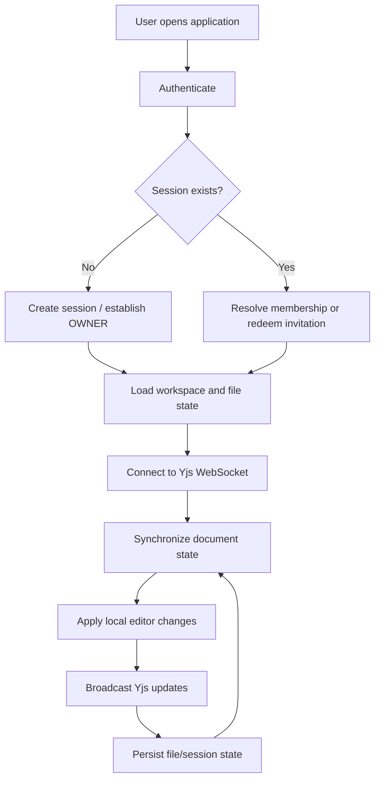

# Collaboration and Authorization Flow

This guide explains the expected session lifecycle and the behaviors that must remain true as collaboration code evolves.

## Session lifecycle

The diagram is a conceptual flow. Exact route names and internal event names may change; keep this guide aligned with implementation and tests.

## Roles are session-scoped

The database stores membership in `SessionMember`, uniquely keyed by session and user. A user can therefore be an OWNER in one session and a VIEWER in another.

| Action | OWNER | EDITOR | VIEWER |
| --- | --- | --- | --- |
| Join and read session | Yes | Yes | Yes |
| Edit collaborative documents | Yes | Yes | No |
| Use terminal / run code | Yes | Yes | No |
| Create or manage invitations | Yes | No | No |
| Manage session members | Yes | No | No |
| Start/stop recording | Yes | No | No |

The server must check the current session membership. UI state is not proof of permission.

## Invitation lifecycle

An invitation carries a session, fixed role, creator, optional maximum use count, use count, optional expiry, and optional revocation timestamp.

Expected invariants:

1. A non-owner cannot create or manage invitations.
2. A revoked invitation cannot be redeemed.
3. An expired invitation cannot be redeemed.
4. An invitation at its maximum use count cannot be redeemed again.
5. Concurrent redemption must not exceed the configured use limit.
6. Redemption creates or updates the intended session membership without elevating an existing user's privileges unexpectedly.
7. Tokens must not be written to application logs.

The collaboration smoke suite exercises invitation lifecycle, limits, and concurrent redemption. Extend those tests whenever invitation semantics change.

## Yjs document synchronization

The browser uses Yjs-backed collaborative state for editor documents. The WebSocket service authenticates a participant and associates the connection with a session. Updates are synchronized between participants; Redis is used for cross-process coordination.

Important properties to preserve:

- Two independent clients converge on the same document state.
- A reconnecting client receives the current document state.
- A VIEWER can receive updates but cannot write document changes.
- A user removed from a session or demoted to VIEWER cannot retain previously granted write access through an existing socket.
- Collaboration continues when participants are connected to different backend processes, provided Redis is correctly configured.

Do not assume that a local two-tab test proves cross-process behavior. Use separate browser contexts and separate backend processes for those acceptance cases.

## Terminal authorization and revocation

Terminal access is privileged. OWNER and EDITOR can use it; VIEWER cannot. Role changes must close active terminal connections that are no longer authorized. Tests should verify both the denial of a new connection and revocation of an already-open connection.

Hosted demo mode intentionally disables Docker-dependent execution. A terminal failure in that mode is expected and must not be reported as a collaboration outage.

## Recording and replay

The recording model stores typed events with offsets, including Yjs updates/snapshots and terminal activity. A recording should be replayable from its initial state and subsequent events.

Regression checks should cover:

- An initial snapshot is captured.
- Later edits appear in the event stream.
- Replay reconstructs the expected final document state.
- Only authorized users can start or stop a recording.
- Buffer flush and graceful shutdown do not silently discard queued events.

## Acceptance matrix

| Scenario | Expected result |
| --- | --- |
| Owner and editor connect to same session | Both see convergent document state |
| Viewer joins same session | Viewer sees updates but cannot write |
| Viewer opens terminal | Server denies access |
| Editor is demoted while connected | Existing privileged sockets are revoked |
| Invite expires or is revoked | Redemption is rejected |
| Invite use limit reached | Additional redemption is rejected |
| Two clients edit concurrently | Both converge without manual refresh |
| Client disconnects and reconnects | Latest state is recovered |
| Clients connect to separate backend processes | Redis-backed synchronization remains functional |
| Hosted demo terminal is requested | Execution is unavailable by design |

See [TESTING_STRATEGY.md](TESTING_STRATEGY.md) for how to run and extend these checks.
